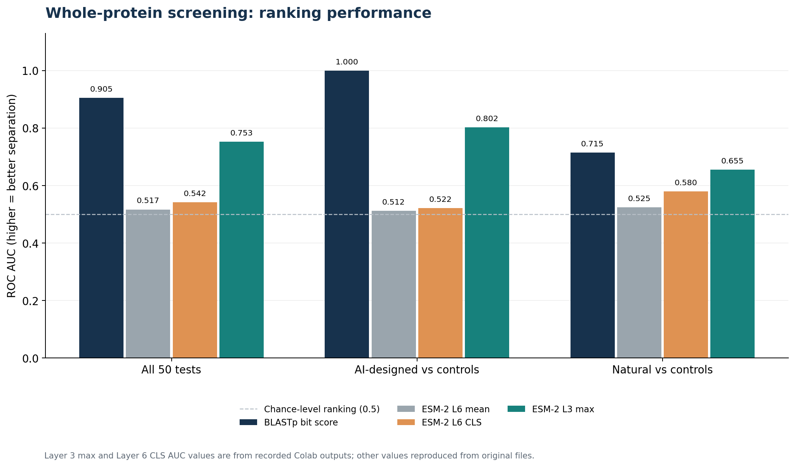

# Evaluating Protein Language Models for Function-Based Screening of Heme-Binding Proteins Against Traditional Sequence-Search Methods

**Research pilot | Phase 1: initial analysis completed | Phase 2: proposed**

## Research question

Can protein language model representations identify heme-binding proteins with divergent amino-acid sequences that traditional sequence-search methods may miss, without increasing false-positive predictions?

## Study design

We compared a traditional protein sequence-search method (**BLASTp**) with representations from the pretrained **ESM-2 (8M)** protein language model. Both approaches used the same collection of 30 heme-binding reference proteins.

| Protein group | Number | Role |
|---|---:|---|
| Heme-binding reference proteins | 30 | Search/reference collection |
| ProteinMPNN-designed myoglobins | 20 | Positive test proteins |
| Natural heme-binding proteins | 10 | Positive test proteins |
| Negative controls | 20 | Negative test proteins |
| **Total** | **80** | **30 references, 50 test proteins** |

- **BLASTp:** Each test protein was scored by its highest alignment bit score against the references. We also recorded E-values, sequence identity, and query coverage. **E-value ≤ 0.01** was used to identify significant sequence matches.
- **ESM-2:** Each test protein was scored by its highest cosine similarity to a reference embedding. We evaluated final-layer mean pooling, final-layer first-token (CLS/BOS) pooling, Layer 3 mean pooling, and Layer 3 max pooling.
- **Evaluation:** We used ROC AUC to assess how well each score ranked heme-binding proteins above negative controls, reporting designed and natural positives separately.

## Phase 1 results

### Ranking performance (ROC AUC)

| Method | All positives vs controls | Designed positives vs controls | Natural positives vs controls |
|---|---:|---:|---:|
| **BLASTp (best bit score)** | **0.905** | **1.000** | **0.715** |
| ESM-2, Layer 6 mean pooling | 0.517 | 0.512 | 0.525 |
| ESM-2, Layer 6 CLS/BOS pooling | 0.542 | 0.522 | 0.580 |
| ESM-2, Layer 3 mean pooling | 0.542 | 0.547 | 0.530 |
| ESM-2, Layer 3 max pooling | 0.753 | 0.802 | 0.655 |

All **20 designed myoglobins** had significant BLASTp matches. Of the **10 natural positives**, **7** had no significant match to the fixed 30-reference BLASTp collection.

### Focused analysis: seven natural positives without significant BLASTp matches

| Method | ROC AUC | Positives detected | Controls flagged |
|---|---:|---:|---:|
| BLASTp best bit score | 0.593 | 0/7 | 1/20 |
| ESM-2 Layer 3 mean pooling | 0.486 | 1/7 | 1/20 |
| ESM-2 Layer 3 max pooling | 0.586 | 1/7 | 1/20 |

The detection counts use cutoffs selected to flag **one of the 20 controls** in this dataset. Among these seven proteins, the tested whole-protein ESM-2 representations **did not demonstrate a clear advantage over BLASTp**. Layer 3 max pooling improved ESM-2's overall AUC relative to mean pooling, but did not surpass BLASTp.

## Repository contents

| Folder | Contents |
|---|---|
| [`data/`](data/) | Master 80-protein dataset in CSV and FASTA formats |
| [`notebooks/`](notebooks/) | Colab workflows for dataset preparation, BLASTp, ESM-2, and evaluation |
| [`results/`](results/) | Available original BLASTp and ESM-2 exports and a comparison workbook |
| [`figures/`](figures/) | Performance figures and a figure-generation script |
| [`docs/`](docs/) | Research overview, detailed methods, Phase 1 findings, and limitations |

## Reproduce the analysis

Open the notebooks in Google Colab in numerical order:

1. [`01_dataset_preparation.ipynb`](notebooks/01_dataset_preparation.ipynb) — assemble and validate the dataset, or use the committed dataset in `data/`.
2. [`02_blastp_analysis.ipynb`](notebooks/02_blastp_analysis.ipynb) — create the 30-protein BLAST database and run the sequence-search baseline, including the matched-length NOS3 check.
3. [`03_esm2_analysis.ipynb`](notebooks/03_esm2_analysis.ipynb) — compute ESM-2 embeddings and the pooling-method comparison.
4. [`04_performance_evaluation.ipynb`](notebooks/04_performance_evaluation.ipynb) — calculate AUCs, inspect protein length, and compare the seven natural positives without significant BLASTp matches.

The Colab workflows use an internet connection to install dependencies and download model weights or source sequences. The consolidated notebooks have not yet been independently rerun end-to-end as a set. Some later per-protein Colab exports are not included in `results/`; their reported metrics are documented in [`docs/03_phase1_results.md`](docs/03_phase1_results.md).

## Limitations and next phase

The natural-positive dataset is small; the 20 AI-designed proteins share a myoglobin design scaffold; and the negative controls were not independently assayed for absence of heme binding. The seven-protein analysis was selected using BLASTp results, and its operating-point cutoff was determined on the same controls used for evaluation. These findings therefore describe this pilot dataset and scoring methods, rather than general screening performance. Full discussion: [`docs/04_limitations_and_next_phase.md`](docs/04_limitations_and_next_phase.md).

**Proposed Phase 2:** Test whether ESM-2 residue-level representations associated with experimentally characterised heme-binding regions provide more function-specific signals than whole-protein embeddings.

## Data source

The designed myoglobin sequences were taken from the supplementary material accompanying Sumida et al. (2024), [*Improving Protein Expression, Stability, and Function with ProteinMPNN*](https://pmc.ncbi.nlm.nih.gov/articles/PMC10811672/). Natural protein sequences were retrieved using the accession IDs recorded in the master dataset.
